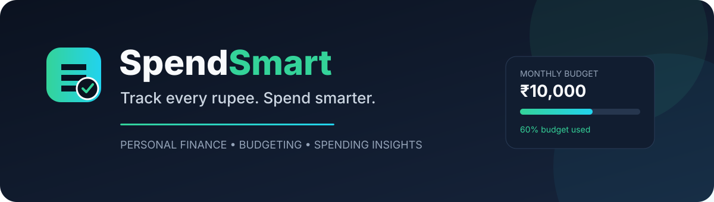
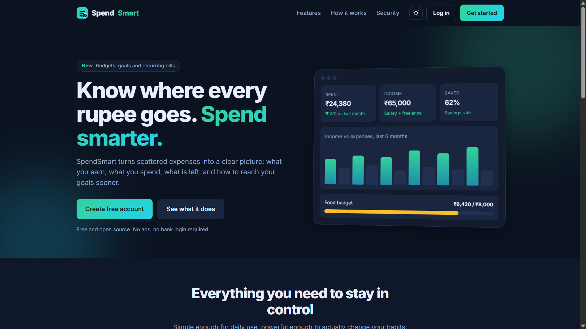
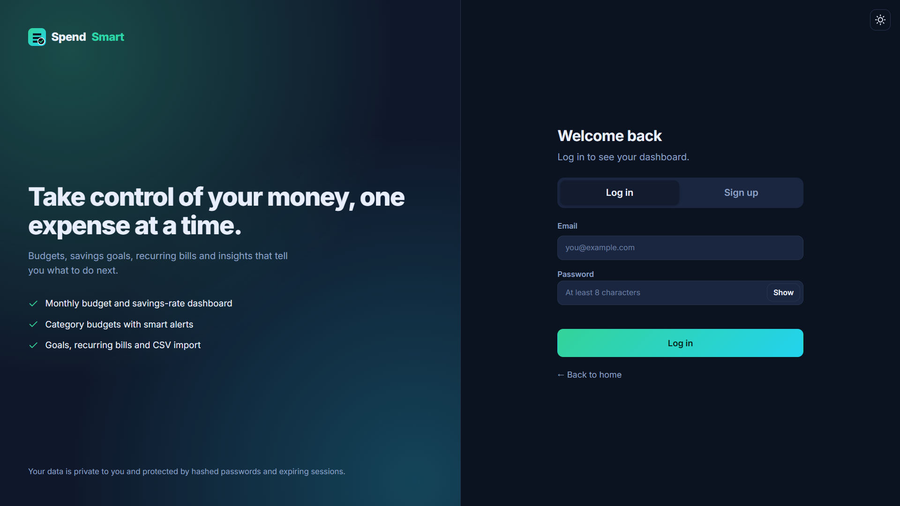
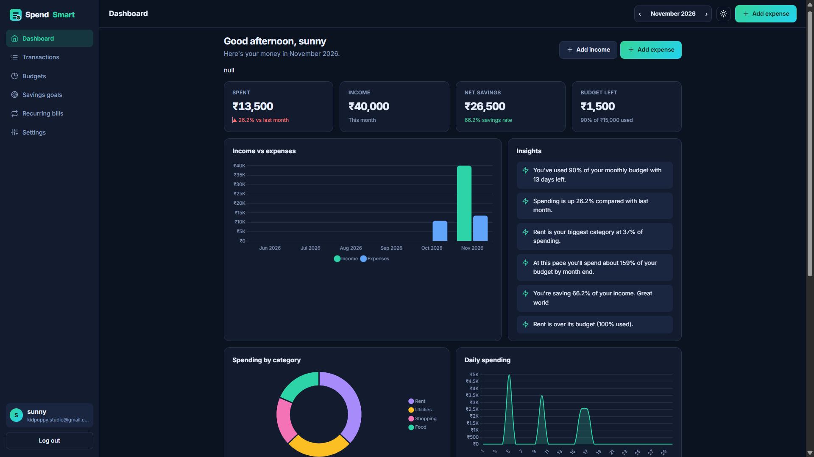
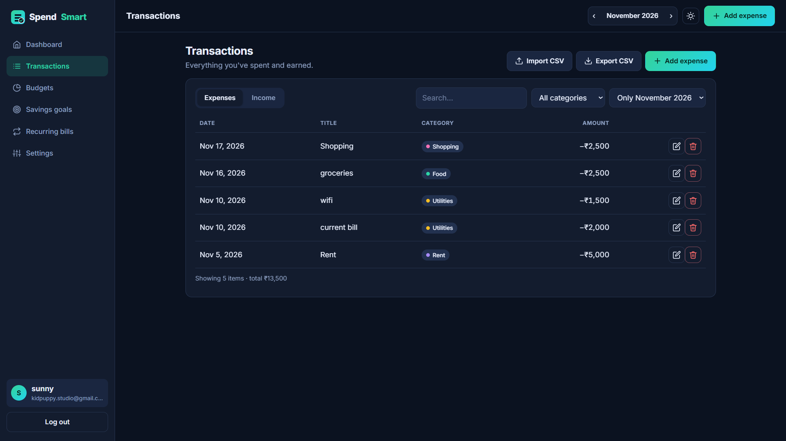
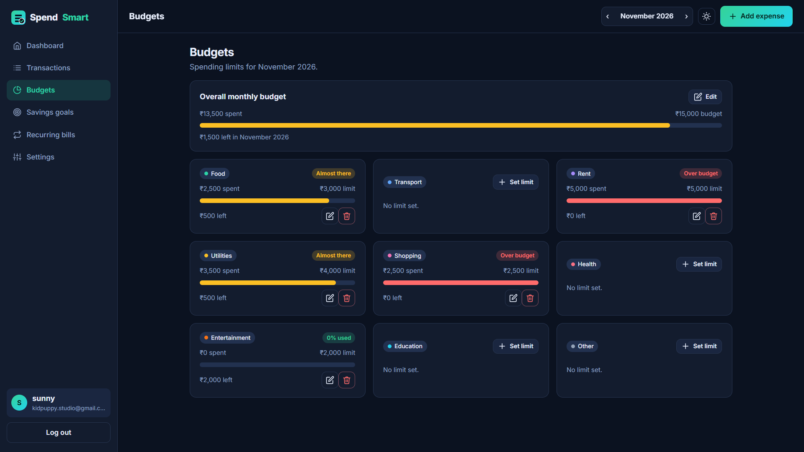
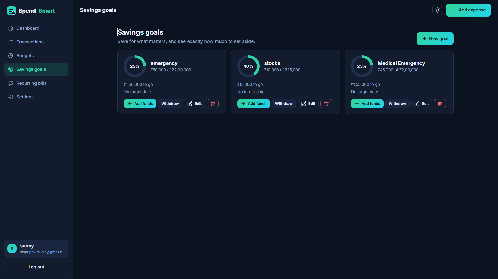
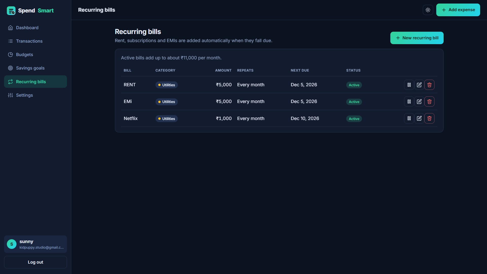

<div align="center">



</div>

# 💸 SpendSmart

### Track Every Rupee. Spend Smarter.

A full-stack personal finance web app built with **FastAPI, SQLAlchemy and vanilla JavaScript**. Track expenses and income, set category budgets, follow savings goals, automate recurring bills and get plain-English spending insights, all behind secure authentication.

<br>

[](https://spendsmart-794k.onrender.com)
[](https://github.com/SaiKiran0078/spendsmart)

<br>

[](https://github.com/SaiKiran0078/spendsmart/actions/workflows/ci.yml)


---

## 📌 Table of Contents

- [✨ Overview](#-overview)
- [🆕 What's New in v2](#-whats-new-in-v2)
- [📸 Screenshots](#-screenshots)
- [🌟 Features](#-features)
- [🛠️ Technology Stack](#️-technology-stack)
- [🏗️ Architecture](#️-architecture)
- [📂 Project Structure](#-project-structure)
- [⚙️ Getting Started](#️-getting-started)
- [🐳 Docker](#-docker)
- [🔐 Configuration](#-configuration)
- [🎬 Demo Data](#-demo-data)
- [🔌 API Overview](#-api-overview)
- [🧪 Testing & Code Quality](#-testing--code-quality)
- [☁️ Deployment](#️-deployment)
- [🔒 Security](#-security)
- [🗺️ Roadmap](#️-roadmap)
- [📚 Documentation](#-documentation)
- [👨‍💻 Author](#-author)

---

## ✨ Overview

Most people don't know where their money goes until the month is over. **SpendSmart** makes it easy to log what you earn and spend, set limits, and see — at a glance — what is left, what is trending, and what to do next.

It is built as a portfolio project that demonstrates production-style practices: layered architecture, authentication and authorisation, input validation, automated tests, CI, containerisation and deployment.

## 🆕 What's New in v2

| Area | Upgrade |
|---|---|
| **Website** | Marketing landing page, dedicated sign-in page and a multi-page dashboard app (sidebar navigation, month switcher, light/dark theme, mobile-friendly) |
| **Insights** | Savings rate, comparison with last month, month-end projection, daily spending chart, top expenses and plain-English tips |
| **Income** | Track income alongside expenses; 6-month income-vs-expenses chart |
| **Category budgets** | Per-category limits with *ok / warning / over* status |
| **Savings goals** | Progress rings, add/withdraw funds and a "save X per month" hint |
| **Recurring bills** | Weekly / monthly / yearly bills that are added automatically when due; pause and resume |
| **CSV import** | Bulk-add expenses from a CSV (flexible dates and amounts); exports re-import cleanly |
| **Account tools** | Edit profile, change password, delete account and all data |
| **Security** | Login rate-limiting, security headers + Content-Security-Policy |
| **Quality** | 100+ automated tests, demo-data seed script, versioned API (`2.0.0`) |

All v1 endpoints keep working, and no existing database tables were altered, so an existing deployment upgrades without migrations (new tables are created on start-up).

## 📸 Application Screenshots

The screenshots below are captured from the running SpendSmart application. The landing-page capture is retained; the authenticated application screens have been refreshed.

<p align="center">
  
</p>
<p align="center">
  
</p>
<p align="center">
  
</p>
<p align="center">
  
</p>
<p align="center">
  
</p>
<p align="center">
  
</p>
<p align="center">
  
</p>


## 🌟 Features

### 📊 Dashboard & insights
- Monthly spent / income / net savings / budget-left cards with change vs. last month
- Income-vs-expenses chart (6 months), category doughnut and daily spending line
- Month-end **projection** and **plain-English insights** (e.g. *"Food is your biggest category at 38%"*)
- Upcoming bills and biggest expenses

### 💰 Transactions
- Expenses **and** income with add / edit / delete
- Search, category filter, month or all-time scope, pagination
- **CSV import & export** (formula-injection safe, round-trip friendly)

### 🎯 Budgets
- Overall monthly budget with progress bar
- Per-category limits that turn amber at 80 % and red at 100 %

### 🏆 Savings goals
- Target amount and optional date, progress ring, add or withdraw funds
- Automatic monthly-saving suggestion to hit the date

### 🔁 Recurring bills
- Weekly, monthly or yearly; month-end dates handled correctly (31st → 30th/28th, then back)
- Added automatically when due; idempotent; pause/resume

### 👤 Account
- Register / login with JWT, change password, update profile, delete account and all data
- Light/dark theme and currency display preference

### 📱 Responsive experience
- Adaptive layouts for desktop, tablet and narrow mobile screens
- Touch-friendly navigation, controls and forms with a slide-in mobile sidebar
- Responsive KPI cards, charts, category cards and horizontally scrollable data tables
- Reduced-motion support and safe-area spacing for modern mobile devices
- Installable Progressive Web App shell with app icons and a service worker; private API responses are never cached\n
## 🛠️ Technology Stack

| Layer | Technologies |
|---|---|
| Backend | Python 3.12, FastAPI, Pydantic v2 |
| Database | SQLAlchemy 2.0 ORM, SQLite (default) |
| Auth & security | JWT (PyJWT), bcrypt, in-memory login rate-limiter, CSP + security headers |
| Frontend | HTML5, CSS3 (design tokens), vanilla JavaScript (ES modules), Chart.js |
| Testing | pytest, pytest-cov, httpx |
| Quality | Ruff |
| DevOps | Docker, Docker Compose, GitHub Actions, Render |

## 🏗️ Architecture

```text
Browser (landing · login · dashboard SPA)
        │  JSON + JWT bearer token
        ▼
FastAPI  ──►  Routers (auth · expenses · income · budgets · goals · recurring · summary)
                 │
                 ├─► Services (analytics · recurring · goals · dates)   ← business logic
                 ├─► Pydantic schemas                                   ← validation
                 └─► SQLAlchemy models ─► SQLite
```

Routers stay thin; calculations live in `app/services/` so they are easy to unit-test. See [`docs/ARCHITECTURE.md`](docs/ARCHITECTURE.md) for diagrams and design decisions.

## 📂 Project Structure

```text
spendsmart/
├── .github/
│   ├── ISSUE_TEMPLATE/
│   ├── pull_request_template.md
│   └── workflows/ci.yml
├── app/                      # FastAPI backend
│   ├── main.py               # App, middleware, routers, static site
│   ├── config.py  database.py  models.py  schemas.py
│   ├── security.py  deps.py  ratelimit.py
│   ├── routers/              # auth · expenses · income · budgets · goals · recurring · summary
│   └── services/             # analytics · recurring · goals · dates
├── frontend/                 # Static website (served by FastAPI)
│   ├── index.html            # Landing page
│   ├── login.html            # Sign in / sign up
│   ├── app.html              # Dashboard shell
│   ├── manifest.webmanifest  # Installable app metadata
│   ├── sw.js                 # Static-shell service worker (API is network-only)
│   ├── assets/               # Logo, favicon and PWA icons
│   ├── css/                  # theme.css · landing.css · app.css
│   └── js/                   # api · ui · forms · charts · router, plus pages/
├── tests/                    # 100+ pytest tests
├── scripts/seed_demo.py      # Demo data generator
├── docs/                     # API.md · ARCHITECTURE.md · QUALITY_REVIEW.md
├── assets/
│   ├── banner.svg
│   └── readme/screenshots/    # Actual product screenshots used above
├── Dockerfile  docker-compose.yml  Makefile
├── pyproject.toml  requirements*.txt  .env.example
└── README.md  LICENSE  CONTRIBUTING.md
```

## ⚙️ Getting Started

**Prerequisites:** Python 3.12, Git (Docker optional).

```bash
git clone https://github.com/SaiKiran0078/spendsmart.git
cd spendsmart
```

**Create a virtual environment**

```powershell
# Windows PowerShell
py -3.12 -m venv .venv
.\.venv\Scripts\Activate.ps1
```
```bash
# macOS / Linux
python3.12 -m venv .venv && source .venv/bin/activate
```

**Install, configure, run**

```bash
pip install -r requirements-dev.txt
cp .env.example .env          # Windows: Copy-Item .env.example .env
# edit .env and set a strong SECRET_KEY (32+ characters)
uvicorn app.main:app --reload
```

Open **http://127.0.0.1:8000** for the website and **http://127.0.0.1:8000/docs** for the interactive API docs.

## 🐳 Docker

```bash
cp .env.example .env   # set SECRET_KEY
docker compose up --build -d
```

The app is served at http://localhost:8000 and data persists in a Docker volume. Stop it with `docker compose down`.

## 🔐 Configuration

| Variable | Required | Description |
|---|---|---|
| `SECRET_KEY` | ✅ | JWT signing secret, **at least 32 characters**, placeholder values are rejected |
| `ALGORITHM` | | JWT algorithm (default `HS256`) |
| `ACCESS_TOKEN_EXPIRE_MINUTES` | | Token lifetime (default `60`) |
| `DATABASE_URL` | | SQLAlchemy URL (default `sqlite:///./data/spendsmart.db`) |
| `LOGIN_MAX_ATTEMPTS` | | Failed logins allowed per email + IP before lock-out (default `5`) |
| `LOGIN_WINDOW_SECONDS` | | Lock-out window (default `900`) |

Generate a secret: `python -c "import secrets; print(secrets.token_urlsafe(48))"`

**Never commit your `.env` file.**

## 🎬 Demo Data

Fill a local database with three months of realistic data (great for screenshots):

```bash
make seed            # or: python -m scripts.seed_demo
```

Then log in with **demo@spendsmart.app** / **Demo@12345**.

## 🔌 API Overview

| Area | Endpoints |
|---|---|
| Auth | `POST /api/auth/register` · `POST /api/auth/login` · `GET/PUT /api/auth/me` · `PUT /api/auth/me/budget` · `POST /api/auth/me/password` · `DELETE /api/auth/me` |
| Expenses | `GET/POST /api/expenses` · `GET/PUT/DELETE /api/expenses/{id}` · `GET /api/expenses/export/csv` · `POST /api/expenses/import/csv` |
| Income | `GET/POST /api/income` · `PUT/DELETE /api/income/{id}` |
| Category budgets | `GET /api/budgets` · `PUT/DELETE /api/budgets/{category}` |
| Goals | `GET/POST /api/goals` · `PUT/DELETE /api/goals/{id}` · `POST /api/goals/{id}/contribute` |
| Recurring | `GET/POST /api/recurring` · `PUT/DELETE /api/recurring/{id}` · `POST /api/recurring/process` |
| Analytics | `GET /api/summary` · `GET /api/summary/trend` |
| Health | `GET /api/health` |

Full reference with examples: [`docs/API.md`](docs/API.md).

## 🧪 Testing & Code Quality

```bash
make test      # pytest with coverage
make lint      # ruff check
```

The suite covers authentication, rate limiting, account deletion, CRUD for every resource, validation, cross-user isolation, CSV import/export round-trips, budget status, goal pacing, recurring-bill generation (including idempotency and month-end handling) and analytics. Tests use an isolated in-memory database. GitHub Actions runs Ruff, Python compilation, JavaScript syntax checks, the test suite and a Docker build on every push and pull request.

## ☁️ Deployment

SpendSmart runs as a Docker web service on Render and honours the platform's `PORT` variable.

1. Push to GitHub and connect the repository to a Render **Docker** web service.
2. Add the environment variables above (at minimum `SECRET_KEY`).
3. Set the health-check path to `/api/health` and deploy.

**Live:** https://spendsmart-794k.onrender.com

> Free hosting may sleep after inactivity, and SQLite data on an ephemeral filesystem can be lost on redeploy. For durable data use a persistent disk or a managed database.

## 🔒 Security

- Passwords hashed with **bcrypt** (72-byte limit enforced, never returned by the API)
- **JWT** access tokens with expiry; secret validated at start-up
- **Rate-limited login** with `429` + `Retry-After`
- Every query is **scoped to the owner**; other users' records return `404`
- Strict **Pydantic validation** (types, ranges, enums, blank-string checks)
- **Content-Security-Policy**, `X-Frame-Options`, `nosniff` and `Referrer-Policy` headers
- UI renders data with `textContent` (no `innerHTML`) to prevent **XSS**
- **CSV formula-injection** protection on export, reversed safely on import
- Docker image runs as a **non-root** user

*SpendSmart is a portfolio project, not a certified financial or banking system.*

## 🗺️ Roadmap

- [ ] Alembic migrations and PostgreSQL in `docker-compose`
- [ ] Refresh tokens and password reset by email
- [ ] Shared / household budgets
- [ ] Receipt attachments
- [ ] Installable PWA with offline support

## 📚 Documentation

- [API reference](docs/API.md)
- [Architecture & design decisions](docs/ARCHITECTURE.md)
- [Quality review](docs/QUALITY_REVIEW.md)
- [Contributing](CONTRIBUTING.md)

## 👨‍💻 Author

<div align="center">

### Sajjarapu Sai Kiran

<br>

[](https://github.com/SaiKiran0078)
[](https://github.com/SaiKiran0078/spendsmart)
[](https://spendsmart-794k.onrender.com)

</div>

---

<div align="center">

**Built with Python, FastAPI, and a focus on practical financial management.**

⭐ If you find this project interesting, consider starring the repository!

</div>
