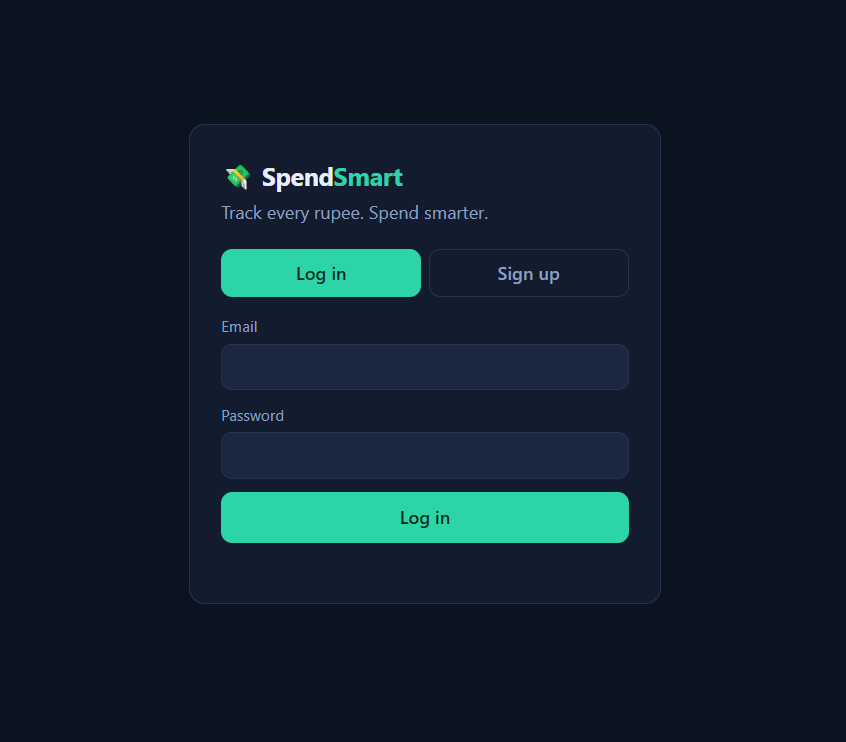
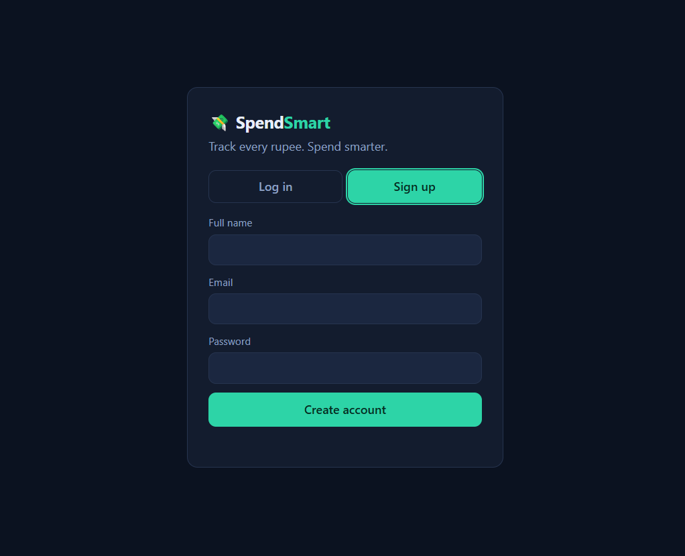
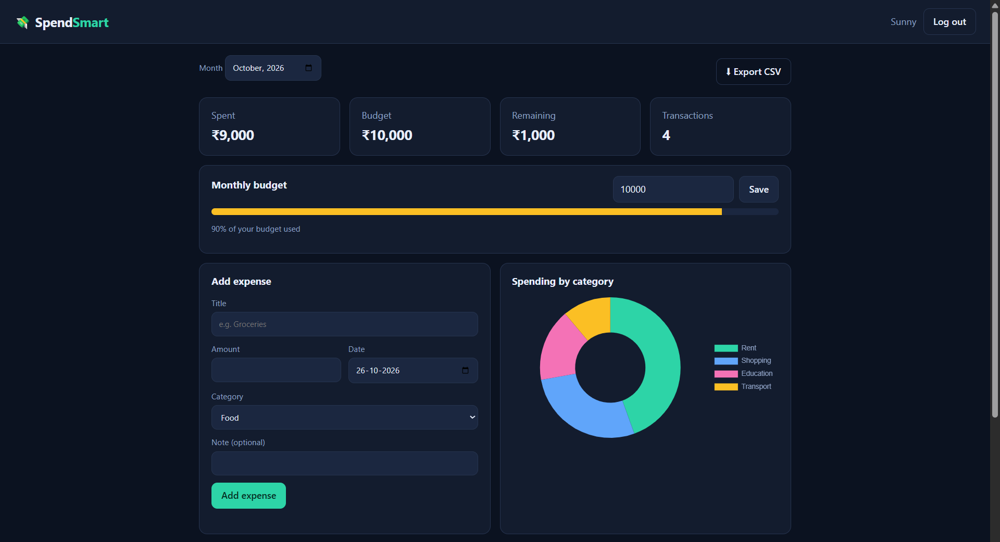
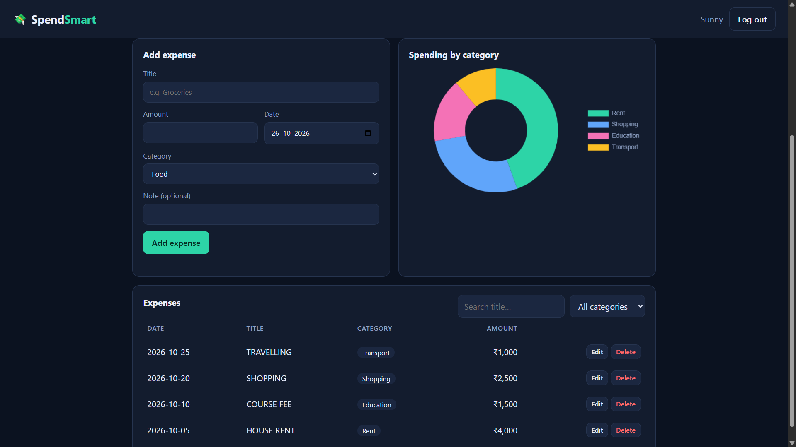

<div align="center">


</div>

# 💸 SpendSmart

### Track Every Rupee. Spend Smarter.

A modern, full-stack expense tracking application built with **FastAPI, SQLAlchemy, and vanilla JavaScript** to help users manage expenses, monitor monthly budgets, visualize spending patterns, and export transaction records.

<br>

[](https://spendsmart-794k.onrender.com)
[](https://github.com/SaiKiran0078/spendsmart)

<br>


</div>

---

## 📌 Table of Contents

- [✨ Overview](#-overview)
- [🚀 Live Application](#-live-application)
- [📸 Application Screenshots](#-application-screenshots)
- [🌟 Key Features](#-key-features)
- [🛠️ Technology Stack](#️-technology-stack)
- [🏗️ Architecture](#️-architecture)
- [📂 Project Structure](#-project-structure)
- [⚙️ Getting Started](#️-getting-started)
- [🐳 Docker Setup](#-docker-setup)
- [🔐 Environment Configuration](#-environment-configuration)
- [🔌 API Overview](#-api-overview)
- [🧪 Testing and Code Quality](#-testing-and-code-quality)
- [☁️ Deployment](#️-deployment)
- [📚 Documentation](#-documentation)
- [🔒 Security Considerations](#-security-considerations)
- [🗺️ Future Improvements](#️-future-improvements)
- [👨‍💻 Author](#-author)

---

## ✨ Overview

**SpendSmart** is a web-based personal expense management application designed to make everyday financial tracking straightforward and accessible.

Users can create an account, securely log in, record transactions, organize expenses by category, set a monthly budget, and review their spending through a visual dashboard.

The application combines a lightweight JavaScript frontend with a Python backend, RESTful API endpoints, database persistence, and containerized deployment.

### 🎯 Project Objectives

- Simplify personal expense tracking.
- Provide a clear overview of monthly spending.
- Help users compare expenses against their budget.
- Make transaction records searchable and exportable.
- Demonstrate practical full-stack development, API design, testing, and deployment.

---

## 🚀 Live Application

**Try SpendSmart:** https://spendsmart-794k.onrender.com

The application is deployed as a Docker-based web service on Render.

> **Demo note:** The free hosting environment may take a short time to respond after inactivity. Treat the live instance as a demonstration rather than a permanent financial record system. Data persistence depends on the deployed database configuration and hosting storage.

---

## 📸 Application Screenshots

The screenshots below show the application's authentication pages and expense management interface.

### 🔐 Login

Sign in to access the expense dashboard.

<p align="center">
  
</p>

### 📝 Create an Account

Register an account with your name, email address, and password.

<p align="center">
  
</p>

### 📊 Dashboard

Review monthly spending, budget allocation, remaining balance, transaction count, and category-wise spending.

<p align="center">
  
</p>

### 💳 Expense Management

View recorded transactions, search by title, filter by category, and access available editing and deletion actions.

<p align="center">
  
</p>

---

## 🌟 Key Features

### 👤 1. User Authentication

- User registration and login.
- Password hashing with bcrypt.
- JWT-based authentication.
- Protected API endpoints for authenticated operations.

### 💰 2. Expense Management

- Add expenses with a title, amount, date, category, and optional note.
- View recorded transactions.
- Edit existing expenses.
- Delete expenses when they are no longer needed.
- Organize spending by category.

### 📊 3. Financial Dashboard

- Total spending for the selected month.
- Monthly budget.
- Remaining budget.
- Number of transactions.
- Category-wise spending visualization.
- Visual indication of budget utilization.

### 🎯 4. Monthly Budget Tracking

- Set a monthly spending budget.
- Compare recorded spending with the configured budget.
- View the remaining budget and percentage utilized.

### 🔎 5. Search and Filtering

- Search expenses by title.
- Filter transactions by category.
- Review relevant transaction records more easily.

### 📥 6. CSV Export

Export expense records as a CSV file for further analysis using spreadsheet applications or data analysis tools.

### 🐳 7. Containerized Deployment

- Docker-based application packaging.
- Docker Compose configuration for local execution.
- Environment-based configuration.
- Health-check support.
- GitHub Actions continuous integration workflow.

---

## 🛠️ Technology Stack

| Layer | Technologies | Purpose |
|---|---|---|
| Backend | Python, FastAPI | Application logic and REST API |
| Data Validation | Pydantic | Request and configuration validation |
| Database Access | SQLAlchemy | Database models and persistence |
| Database | SQLite by default | Relational data storage |
| Authentication | JWT, PyJWT | Token-based authentication |
| Password Security | bcrypt | Password hashing |
| Frontend | HTML5, CSS3, JavaScript | User interface and interactions |
| Data Visualization | JavaScript charting | Category-wise spending visualization |
| Testing | Pytest | Automated testing |
| Linting | Ruff | Python code-quality checks |
| Containerization | Docker, Docker Compose | Reproducible application execution |
| CI/CD | GitHub Actions | Automated testing, linting, and image build |
| Deployment | Render | Public web application hosting |
| Version Control | Git, GitHub | Source control and collaboration |

---

## 🏗️ Architecture

SpendSmart follows a client-server architecture.

```text
┌────────────────────────────────────────────┐
│               User / Browser               │
└──────────────────────┬─────────────────────┘
                       │
                       ▼
┌────────────────────────────────────────────┐
│             Frontend Application           │
│                                            │
│       HTML  │  CSS  │  JavaScript          │
└──────────────────────┬─────────────────────┘
                       │
                       │ HTTP / JSON
                       ▼
┌────────────────────────────────────────────┐
│              FastAPI Backend               │
│                                            │
│   Authentication │ Validation │ Endpoints  │
└──────────────────────┬─────────────────────┘
                       │
                       ▼
┌────────────────────────────────────────────┐
│             SQLAlchemy ORM                 │
└──────────────────────┬─────────────────────┘
                       │
                       ▼
┌────────────────────────────────────────────┐
│          Relational Database               │
│                 SQLite                     │
└────────────────────────────────────────────┘
```

### Request Flow

1. A user interacts with the frontend.
2. JavaScript sends HTTP requests to the FastAPI backend.
3. The backend validates the request and checks authentication where required.
4. SQLAlchemy handles database operations.
5. The API returns the appropriate response.
6. The frontend updates the displayed information.

---

## 📂 Project Structure

```text
spendsmart/
│
├── .github/
│   ├── ISSUE_TEMPLATE/
│   ├── PULL_REQUEST_TEMPLATE.md
│   └── workflows/
│       └── ci.yml
│
├── app/
│   ├── main.py
│   ├── config.py
│   ├── database.py
│   ├── models.py
│   ├── schemas.py
│   ├── security.py
│   └── ...
│
├── frontend/
│   ├── index.html
│   ├── css/
│   │   └── style.css
│   └── js/
│       └── app.js
│
├── tests/
│   ├── conftest.py
│   └── ...
│
├── docs/
│   ├── API.md
│   ├── ARCHITECTURE.md
│   ├── QUALITY_REVIEW.md
│   └── screenshots/
│       ├── login.png
│       ├── register.png
│       ├── dashboard.png
│       └── expenses.png
│
├── .env.example
├── .gitattributes
├── .gitignore
├── Dockerfile
├── docker-compose.yml
├── pyproject.toml
├── requirements.txt
├── requirements-dev.txt
└── README.md
```

> **Note:** The tree above highlights the main project components. Keep the file names and folders consistent with the actual repository. The `app/` and `tests/` directories may contain additional modules and test files.

---

## ⚙️ Getting Started

Follow these steps to run SpendSmart locally.

### Prerequisites

Install the following:

- Python 3.12
- Git
- A terminal such as PowerShell, Command Prompt, or Bash

Docker is optional if you prefer containerized execution.

### 1. Clone the Repository

```bash
git clone https://github.com/SaiKiran0078/spendsmart.git
cd spendsmart
```

### 2. Create a Virtual Environment

**Windows PowerShell:**

```powershell
py -3.12 -m venv .venv
.\.venv\Scripts\Activate.ps1
```

If PowerShell blocks activation, you can use Command Prompt instead:

```bat
.venv\Scripts\activate.bat
```

### 3. Install Dependencies

```bash
python -m pip install --upgrade pip
pip install -r requirements.txt
```

For development and testing tools:

```bash
pip install -r requirements-dev.txt
```

### 4. Configure Environment Variables

Create a local `.env` file using `.env.example` as the template.

**PowerShell:**

```powershell
Copy-Item .env.example .env
```

Open `.env` and configure the required values, including a strong, unique `SECRET_KEY` and a suitable `DATABASE_URL`.

Do not commit your `.env` file or share its secret values.

See [Environment Configuration](#-environment-configuration) for details.

### 5. Start the Application

```bash
uvicorn app.main:app --reload
```

Open the application in your browser:

**Frontend:** http://127.0.0.1:8000

**API documentation:** http://127.0.0.1:8000/docs

The API documentation is available when the application exposes FastAPI's interactive documentation endpoints.

To stop the development server, press `Ctrl + C`.

---

## 🐳 Docker Setup

SpendSmart includes a Dockerfile and Docker Compose configuration for containerized execution.

### Prerequisites

Install and start Docker Desktop, or install Docker Engine and the Docker Compose plugin.

### Build the Image

```bash
docker compose build
```

### Start the Application

```bash
docker compose up -d
```

### Check Container Status

```bash
docker compose ps
```

### View Application Logs

```bash
docker compose logs -f
```

### Open SpendSmart

http://localhost:8000

### Stop the Application

```bash
docker compose down
```

To stop the application without deleting its named database volume, use the command above.

> **Important:** Removing named volumes deletes their stored data. Do not use `docker compose down -v` unless you intentionally want to remove the associated volumes.

---

## 🔐 Environment Configuration

SpendSmart uses environment variables for application configuration.

The exact required variables are defined by the application's settings and `.env.example`.

| Variable | Purpose |
|---|---|
| `SECRET_KEY` | Secret used for token-related security |
| `ALGORITHM` | JWT signing algorithm |
| `ACCESS_TOKEN_EXPIRE_MINUTES` | Access-token lifetime |
| `DATABASE_URL` | Database connection string |

Example configuration:

```dotenv
SECRET_KEY=replace_with_a_unique_random_secret
ALGORITHM=HS256
ACCESS_TOKEN_EXPIRE_MINUTES=60
DATABASE_URL=sqlite:///./data/spendsmart.db
```

This is an example, not a production secret. Generate a unique secret for each environment and verify the database path against the application's configuration.

For local development, use `.env`.

For deployment, configure environment variables through the hosting provider's environment settings.

**Never commit real credentials, production secrets, or sensitive user data to GitHub.**

---

## 🔌 API Overview

SpendSmart exposes REST API endpoints for authentication, expense management, budget tracking, summaries, and CSV export.

The following is a functional overview; consult the application's interactive API documentation for the exact route paths, HTTP methods, and request schemas.

| Area | Purpose |
|---|---|
| Authentication | Register accounts and authenticate users |
| Expenses | Create, retrieve, update, and delete expense records |
| Dashboard / Summary | Retrieve spending summaries and transaction statistics |
| Budget | Manage monthly budget information |
| Export | Download transaction records in CSV format |
| Health | Check whether the service is responding |

### Explore the API

When running locally, open:

http://127.0.0.1:8000/docs

The interactive Swagger UI allows you to inspect available endpoints, review schemas, and try API requests.

---

## 🧪 Testing and Code Quality

Automated tests help verify application behavior and reduce regressions.

### Run the Test Suite

```bash
python -m pytest -q
```

The project has **25 passing tests** in the recorded test run.

Test results may change as the application evolves, so run the suite again after making code changes.

### Run Ruff

```bash
ruff check .
```

Ruff checks Python code for supported linting issues.

### Check Git Changes

```bash
git diff --check
```

This checks for common whitespace errors in the current Git diff.

### Continuous Integration

The repository includes a GitHub Actions workflow for automated checks.

The configured CI pipeline has successfully completed the recorded test/lint and Docker image build jobs.

Workflow results can be viewed in the repository's **Actions** tab.

---

## ☁️ Deployment

SpendSmart is deployed on Render using a Docker-based web service.

### Deployment Configuration

- **Source repository:** GitHub
- **Application:** FastAPI
- **Runtime:** Docker
- **Hosting platform:** Render
- **Server:** Uvicorn
- **Port:** Configured to support the hosting platform's `PORT` environment variable

### Deployment Checklist

1. Push the latest application code to GitHub.
2. Create or open the Render web service connected to the repository.
3. Configure the Docker runtime.
4. Add the required environment variables in Render.
5. Set the health-check path to `/api/health` if that endpoint is implemented and returns a successful response.
6. Deploy the latest commit.
7. Check the deployment logs and open the live application.

### Live URL

https://spendsmart-794k.onrender.com

### Hosting Considerations

Free hosting services may suspend inactive services, resulting in a delay when the next request arrives.

Local SQLite data stored on an ephemeral hosting filesystem can be lost during a restart, redeployment, or instance replacement. For reliable long-term persistence, use a supported persistent disk or a managed database and configure the application accordingly.

---

## 📚 Documentation

Additional project documentation is available in the `docs/` directory.

| Document | Description |
|---|---|
| [`API.md`](docs/API.md) | API reference and endpoint documentation |
| [`ARCHITECTURE.md`](docs/ARCHITECTURE.md) | Application structure and architecture |
| [`QUALITY_REVIEW.md`](docs/QUALITY_REVIEW.md) | Project quality review and technical observations |

---

## 🔒 Security Considerations

The application incorporates security-related practices, including:

- Password hashing with bcrypt.
- JWT-based authentication.
- Validation of application settings.
- Environment-based configuration.
- Exclusion of local secrets through `.gitignore`.
- Automated testing of application behavior.

For a production financial application, additional review is recommended for rate limiting, authentication abuse prevention, secret rotation, database backups, HTTPS configuration, dependency updates, and handling of sensitive user information.

**SpendSmart is a portfolio project and should not be treated as a certified financial or banking system.**

---

## 🗺️ Future Improvements

Potential enhancements for future iterations include:

- 📈 Monthly and yearly spending trends.
- 🎯 Category-specific budgets and budget alerts.
- 📊 More advanced financial visualizations.
- 🔁 Recurring expense support.
- 📱 Improved mobile responsiveness.
- 📤 Additional export formats.
- 🗄️ Production-grade persistent database configuration.
- 🚦 Expanded integration tests and test coverage reporting.
- 🔐 Additional authentication and API abuse protections.

These are potential improvements, not claims about currently implemented functionality.

---

## 👨‍💻 Author

<div align="center">

### Sajjarapu Sai Kiran

<br>

[](https://github.com/SaiKiran0078)
[](https://github.com/SaiKiran0078/spendsmart)
[](https://spendsmart-794k.onrender.com)

</div>

---

<div align="center">

**Built with Python, FastAPI, and a focus on practical financial management.**

⭐ If you find this project interesting, consider starring the repository!

</div>