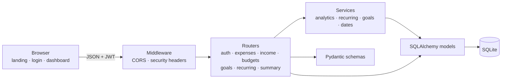
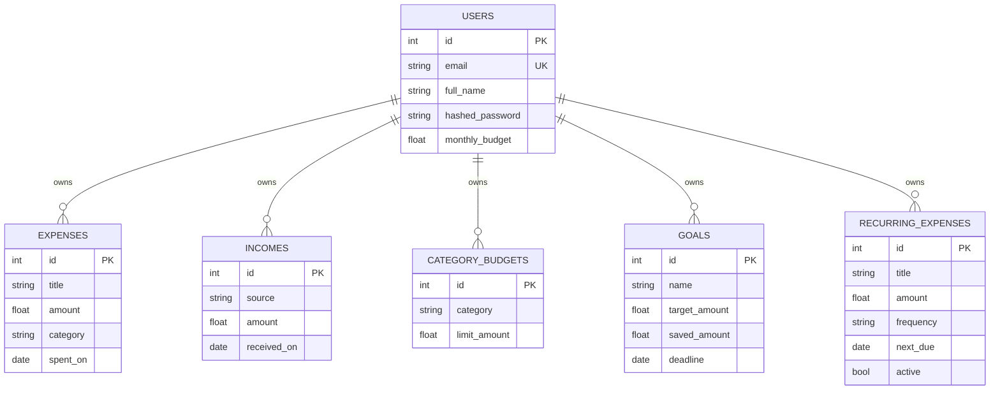

# Architecture

One FastAPI process serves the JSON API (`/api/*`) and the static website (`/`).

## Layers

| Layer | Location | Responsibility |
|---|---|---|
| Routers | `app/routers/` | HTTP concerns: paths, status codes, ownership checks |
| Services | `app/services/` | Business logic: analytics, insights, recurring generation, goal pacing, date maths |
| Schemas | `app/schemas.py` | Request/response validation |
| Models | `app/models.py` | Tables and relationships |
| Security | `security.py`, `deps.py`, `ratelimit.py` | bcrypt, JWT, current-user dependency, login limiter |
| Frontend | `frontend/` | Landing page, sign-in page, dashboard SPA (hash router, ES modules) |

## Design decisions

- **Ownership on every query.** Records of other users return `404`, so existence is never leaked.
- **Pure logic is isolated.** `services/dates.py` has no framework imports, so month arithmetic (leap years, 31st-of-month bills) is unit-tested directly.
- **Idempotent recurring bills.** `next_due` advances as expenses are created, so processing twice never duplicates; a start date anchor stops monthly bills drifting from the 31st to the 28th.
- **Backward compatible.** v2 only adds tables and fields. Existing tables are untouched, so deployed databases upgrade without migrations.
- **No `innerHTML` for data.** The UI builds DOM nodes with `textContent`; combined with a Content-Security-Policy this blocks XSS.
- **Fail-safe config.** The app refuses to start with a missing, short or placeholder `SECRET_KEY`.
- **Limiter trade-off.** The login limiter is in-memory (single instance). For several instances, move it to Redis.

## Data model

## Known limitations

- Amounts use floating point; switch to `Numeric`/integer minor units for real money.
- Tables are created with `create_all`; adopt Alembic before changing existing columns.
- Single-instance rate limiter (see above).
