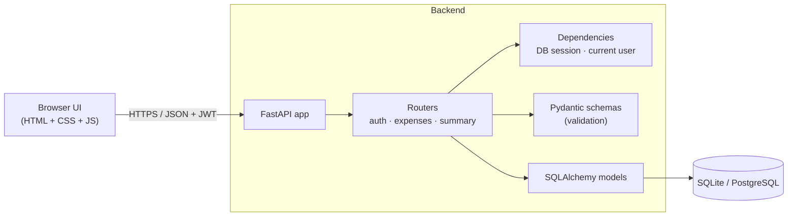
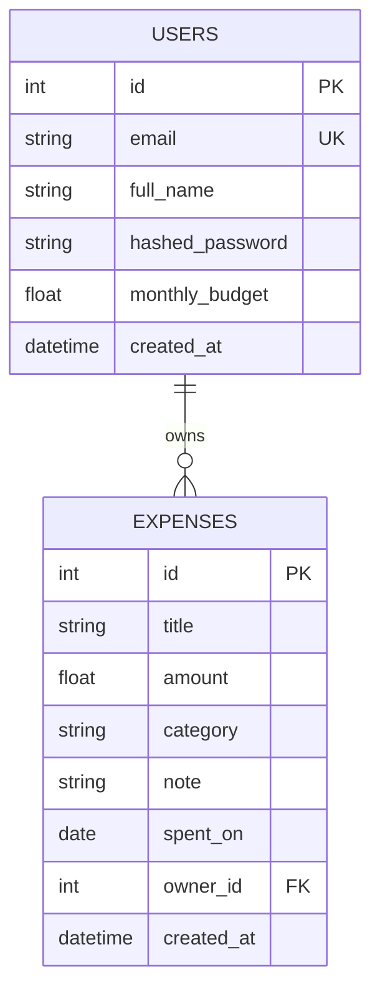

# Architecture

SpendSmart is a small, layered web application. A single FastAPI process serves
both the JSON API (`/api/*`) and the static web UI (`/`).

## Layers

| Layer | Files | Responsibility |
|---|---|---|
| Routers | `app/routers/*.py` | HTTP endpoints, status codes, query params |
| Schemas | `app/schemas.py` | Request/response validation (Pydantic) |
| Models | `app/models.py` | Database tables (SQLAlchemy 2.0 ORM) |
| Security | `app/security.py`, `app/deps.py` | Password hashing (bcrypt), JWT, auth dependency |
| Config | `app/config.py` | Environment-based settings |
| Database | `app/database.py` | Engine, session factory, `get_db` dependency |

## Key design decisions

- **JWT bearer authentication** – stateless, easy to scale; tokens expire (default 60 min).
- **bcrypt password hashing** – plaintext passwords are never stored or returned.
- **Ownership checks on every expense query** – users can only read or change their own data;
  other users' records return `404` so their existence is never leaked.
- **Server-side validation** – amounts must be positive, categories come from a fixed enum.
- **CSV formula-injection guard** – cells starting with `= + - @` are escaped on export.
- **Dependency injection** – DB sessions and the current user are injected, which keeps
  routers thin and makes tests easy (the DB dependency is overridden in `tests/conftest.py`).
- **Config via environment** – no secrets in code; `.env.example` documents every variable.
- **SQLite by default, PostgreSQL-ready** – change `DATABASE_URL` (and add `psycopg`) to switch.

## Data model

